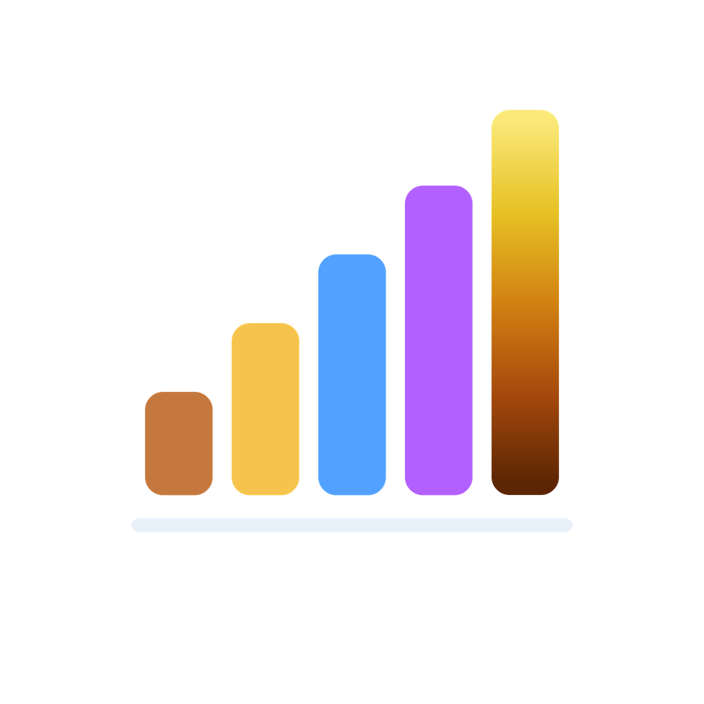
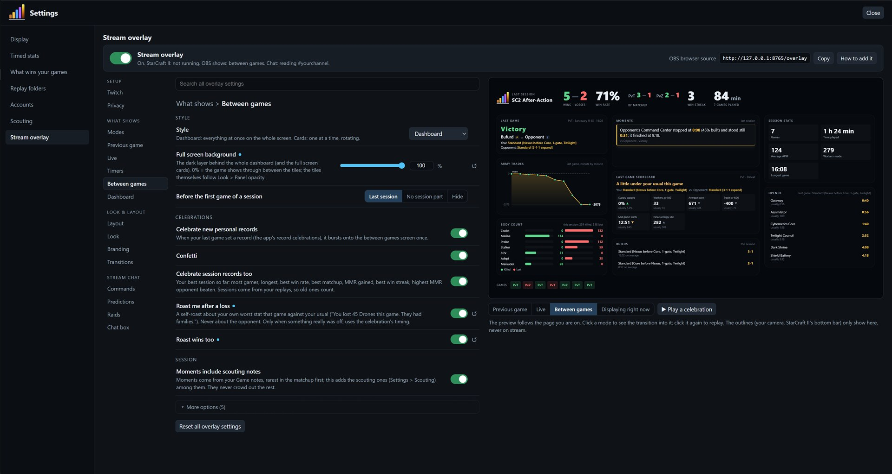

#  SC2 After-Action

**Free after-action reports for your StarCraft II games, on your second monitor.**

After every game you play, SC2 After-Action builds a report you can read between games: what happened with your supply, workers, spending and army, which builds both players went for, and how the game compares with your usual games and with other players at your MMR.

### [⬇ Download the latest version (SC2AfterAction.zip)](https://github.com/bufurd/sc2-after-action/releases/latest/download/SC2AfterAction.zip)

Windows · free · about 18 MB · early alpha · [all versions and release notes](https://github.com/bufurd/sc2-after-action/releases)

---

## Personal records

Every game is checked against all of your earlier games, and when you set a new best the program tells you:

- **MMR highs:** the first time you play at a new round hundred (past 3,500 MMR for the first time, or your best in one matchup). A new MMR high gets a little something extra.
- **Win streaks:** your longest run of ladder wins so far.
- **Clear bests in a matchup:** most workers or income at the checkpoint, lowest bank, least Nexus / Queen / Orbital energy left idle, best inject uptime, fastest max out, highest APM. Only compared with your own games of the same race, matchup and patch era, and only when it beats the old best by a real margin, so it stays a treat.
- **Milestones:** your 100th, 250th, 500th, 1,000th game, and every 500 after.

A record never changes after the fact, so what you saw is what you earned. Games with a record get a trophy in the list and a gold banner on top of their summary, and you can filter the list to just those games. Only your own games count: imports and other players' replays never do. Don't want the popup? Untick "Celebrate personal records" in Settings.

---

## What it shows

- **3 things to look at:** the biggest fixes for this game, each with its number, your usual and what happened in the replay, plus what went well, right at the top.
- **Your build, first 6:00:** every building, army unit and supply building on a timeline, marked on time, late or early against your usual build in that matchup, and the usual pieces that never came. Turn on the opponent's lanes to compare.
- **Builds and game plans** for both players, e.g. *1-gate Stargate → Mass Void Ray* or *Standard → Chargelot Storm*. Games against an early rush are compared with your other games against rushes, not with your normal games.
- **Scouting and key moments:** what you saw and when, and the game's big moments; click one to jump to it on the graphs.
- **Supply blocks** and exactly which Pylon, Depot or Overlord needed to start earlier, and by when.
- **Workers, spending and energy:** workers over time, money left in the bank, Nexus / Queen / Orbital energy, larva and injects.
- **Production idle:** one row per production building, showing when it stood still while you had the money.
- **Graphs** like the in-game score screen and more, with both players on every chart.
- **Your history:** how you usually do in each matchup, what tends to win your games, and your record against the player you just faced.

## For streamers: stream overlay and Twitch chat

Everything here is off until you turn it on in **Settings → Stream overlay**.

- **Stream overlay:** add one link to OBS as a Browser Source. It shows your previous game (result, builds, stats, notes), your record and history against an opponent you have met before as the game starts, and a between-games dashboard with your session record, records, MMR trend and more. Drag the panels into place on a live preview; size, colours, timers, your own logo and what each panel shows are all settings. Hidden MMR stays hidden, and opponent names can show as "Opponent".
- **Chat commands:** viewers type `!lastgame`, `!streak`, `!today`, `!topmu` or `!worst` in your Twitch chat and the answer pops up on the overlay. Mods can `!hide` / `!show` the overlay. The program only reads chat; it never writes in it.
- **Predictions:** `!predict start` opens a vote on your next game, viewers vote `!win` or `!lose`, and the replay settles it. `!tipps` and `!alltipps` show who predicts best. Affiliates and Partners can run it as a real Twitch Prediction with channel points instead.
- **Raids:** a pop-up when someone raids you, and optionally an automatic Twitch shoutout.
- **Roast me:** an optional self-roast about your worst stat after a loss.

## Screenshots

**Summary:** the three things to look at, your build against your usual on a timeline, both armies, scouting, key moments and a tile for every section.

**Graphs:** both players on every chart, with the numbers at the cursor in the bar on top.

**Build order:** everything both players made, with start and finish times and supply.

Opponent names in these screenshots are replaced with "Opponent".

## How to install

1. Download [`SC2AfterAction.zip`](https://github.com/bufurd/sc2-after-action/releases/latest/download/SC2AfterAction.zip) and unzip it anywhere, for example your Desktop. On a release page it is under **Assets**: not the "Source code" zips, which GitHub adds to every release and which hold only this page.
2. Double-click `SC2AfterAction.exe`. A short logo animation plays and your browser opens the dashboard. The program keeps running in the system tray: look for its icon (five coloured bars) by the clock. Windows 10 may put new icons under the **^** arrow; drag it out onto the taskbar to keep it visible.
3. The first time, it reads your replay folders (about a minute for 2,000 replays) and asks which accounts are yours. Tick every account that is you, then Save.
4. Drag the browser window to your second monitor. New games show up a few seconds after they end.

Left-click the tray icon to open the dashboard again. Right-click it for **Open dashboard**, **Rescan replays**, **Start with Windows** (off by default) and **Quit**. Closing the browser tab does not stop the program: to stop it, right-click the tray icon and choose **Quit**.

### "Windows protected your PC" and antivirus warnings

The program is new and not signed with a paid certificate yet, so Windows SmartScreen shows a warning the first time. Click **More info**, then **Run anyway**. Some antivirus programs also flag it: the program is packaged with PyInstaller, a common Python tool that antivirus software often flags in unsigned programs. If yours blocks it, you can allow it, or open an issue and say which antivirus flagged it.

## Your privacy

- **Your replays and stats never leave your computer.** The program only reads the replay files StarCraft II already saves, and shows its reports in your own browser at `http://127.0.0.1:8765`.
- It never changes game files, draws nothing inside the game and does not automate anything in StarCraft II.
- **Internet connections:** one request a day to GitHub for the number of the latest release, so the dashboard can say "A newer version is available". Nothing about you or your games is sent. Turn it off with the switch in Settings, or set `check_updates = 0` in `settings.ini` next to the program.
- **Only if you use the stream features** (all off by default):
  - While the overlay is on, it reads StarCraft II's own local stream-tool page at `http://127.0.0.1:6119` (made by Blizzard for overlays; it never leaves your PC) to know when a game starts.
  - With the overlay and chat on, it reads your Twitch chat anonymously at `irc.chat.twitch.tv`, with no login.
  - Only after you log in to Twitch in Settings (for channel-points predictions or raid shoutouts) does it talk to `id.twitch.tv` and `api.twitch.tv`.
- It keeps its own copy of the numbers in `%APPDATA%\SC2AfterAction` (settings, a cache, a log, and if you use them, `twitch-token.json` for the Twitch login and `chat-predictions.json` for the prediction tallies). Delete that folder to remove everything.

## Known issues

- **Build orders can be incomplete.** The replay records when most things finished, not when they started, so some start times are estimates (marked `~`), and build and game-plan names are the program's best guess from those timings.
- **Many numbers are estimates** rebuilt from timings and may not be exactly right: probes missed, theoretical mining, when supply needed to start, Nexus / Queen / Orbital energy, larva floated, inject uptime and the game plan. They have been checked against the game's own numbers where possible, but read them as a guide, not an exact count. Numbers the game itself reports (income, supply, unspent resources, APM) are exact.
- Protoss is the most developed race; Terran and Zerg analysis is newer.
- Channel-points predictions have only been tested against a stand-in for Twitch so far, not on a live channel. The chat-vote predictions are the default.
- Windows only.

## Feedback and bug reports

- [Open an issue](https://github.com/bufurd/sc2-after-action/issues/new/choose). In the program, click **Share / Compare → Copy diagnostics** and paste the text into the issue: it says which version you run and what went wrong, with no replay files, player names or account IDs.
- Or click **Feedback** at the top of the dashboard for the bug / idea form and the builds survey.

## Licence

SC2 After-Action is free to use for reviewing StarCraft II replays. It is provided **as is, with no warranty**. Please share the link to this page instead of re-uploading the zip; re-hosting, decompiling or modifying the program is not allowed. The open-source parts inside it keep their own licences. Full terms: [LICENSE](LICENSE).

This repository holds the downloads only; the source code is not published at this time.

## Credits

SC2 After-Action is built on open-source software:

- [sc2reader](https://github.com/ggtracker/sc2reader) and [mpyq](https://github.com/eagleflo/mpyq): reading replay files
- [uPlot](https://github.com/leeoniya/uPlot): the graphs
- [pystray](https://github.com/moses-palmer/pystray) and [Pillow](https://python-pillow.org/): the tray icon
- [Python](https://www.python.org/) and [PyInstaller](https://pyinstaller.org/): running and packaging the program

Every open-source component in the download is listed with its licence in [THIRD-PARTY-NOTICES.txt](THIRD-PARTY-NOTICES.txt).

StarCraft and StarCraft II are trademarks of Blizzard Entertainment, Inc. SC2 After-Action is not affiliated with, endorsed by or supported by Blizzard Entertainment.

Designed and tested by Bufurd, built with [Claude Code](https://claude.com/claude-code) (AI-assisted).
