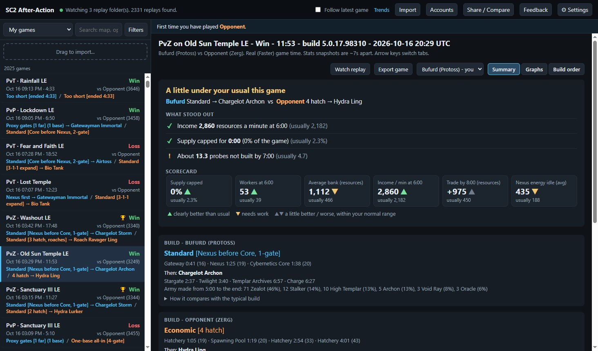
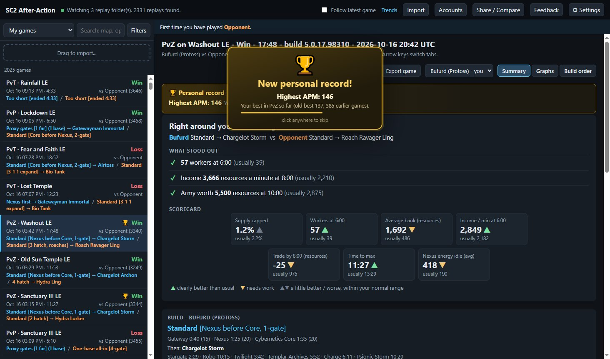
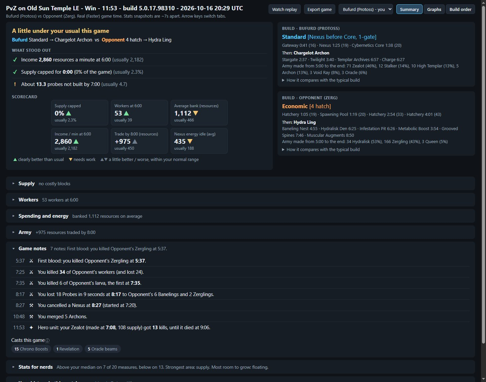
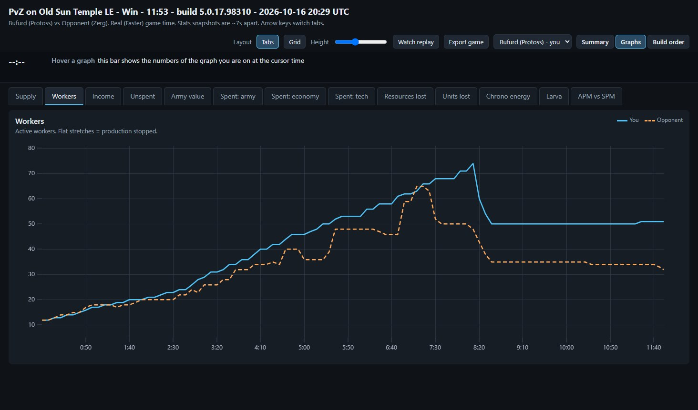
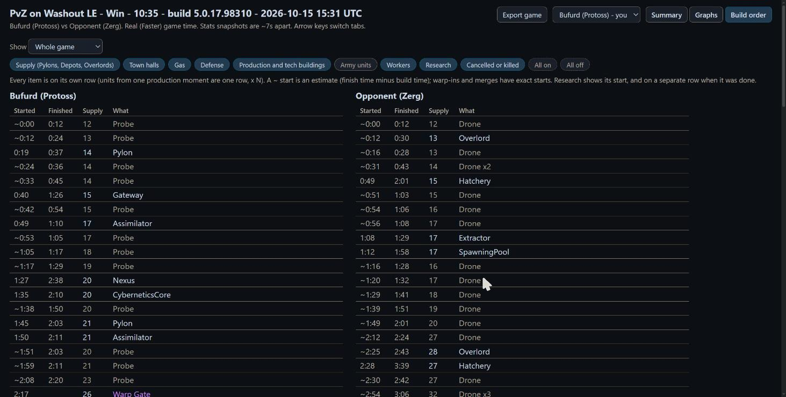

# SC2 After-Action

**Free after-action reports for your StarCraft II games, on your second monitor.**

After every game you play, SC2 After-Action builds a report you can read between games: what happened with your supply, workers, spending and army, which builds both players went for, and how the game compares with your usual games and with other players at your rating.

### [⬇ Download the latest version (SC2AfterAction.zip)](https://github.com/bufurd/sc2-after-action/releases/latest/download/SC2AfterAction.zip)

Windows · free · about 9 MB · early alpha · [all versions and release notes](https://github.com/bufurd/sc2-after-action/releases)

---

## Personal records

Every game is checked against all of your earlier games, and when you set a new best the program tells you:

- **MMR highs:** the first time you play at a new round hundred (past 3,500 MMR for the first time, or your best in one matchup). A new MMR high stays on screen until you click **"Oh yeah, baby, I know it!"**
- **Win streaks:** your longest run of ladder wins so far.
- **Clear bests in a matchup:** most workers or income at the checkpoint, lowest bank, least Nexus / Queen / Orbital energy left idle, best inject uptime, fastest max out, highest APM. Only compared with your own games of the same race, matchup and patch era, and only when it beats the old best by a real margin, so it stays a treat.
- **Milestones:** your 100th, 250th, 500th, 1,000th game, and every 500 after.

A record never changes after the fact, so what you saw is what you earned. Games with a record get a trophy in the list and a gold banner on top of their summary, and you can filter the list to just those games. Only your own games count: imports and other players' replays never do. Don't want the popup? Untick "Celebrate personal records" in Settings.

---

## What it shows

- **What stood out:** up to three things that were clearly better or worse than your usual, right at the top.
- **Builds and game plans** for both players, e.g. *1-gate Stargate → Mass Void Ray* or *Standard → Chargelot Storm*.
- **Supply blocks** and exactly which Pylon, Depot or Overlord needed to start earlier, and by when.
- **Workers, spending and energy:** workers over time, money left in the bank, Nexus / Queen / Orbital energy, larva and injects.
- **Graphs** like the in-game score screen and more, with both players on every chart.
- **Your history:** how you usually do in each matchup, what tends to win your games, and your record against the player you just faced.

## Screenshots

**Summary:** the headline, what stood out, a scorecard against your usual, both builds, and details such as game notes (first blood, a big worker loss, a merged Archon, your hero unit).

**Graphs:** both players on every chart, with the numbers at the cursor in the bar on top.

**Build order:** everything both players made, with start and finish times and supply.

Opponent names in these screenshots are replaced with "Opponent".

## How to install

1. Download [`SC2AfterAction.zip`](https://github.com/bufurd/sc2-after-action/releases/latest/download/SC2AfterAction.zip) and unzip it anywhere, for example your Desktop. On a release page it is under **Assets**: not the "Source code" zips, which GitHub adds to every release and which hold only this page.
2. Double-click `SC2AfterAction.exe`. A black window opens (leave it open, it is the program) and your browser opens the dashboard.
3. The first time, it reads your replay folders and asks which accounts are yours. Tick every account that is you, then Save.
4. Drag the browser window to your second monitor. New games show up a few seconds after they end.

To stop it, close the black window.

### "Windows protected your PC" and antivirus warnings

The program is new and not signed with a paid certificate yet, so Windows SmartScreen shows a warning the first time. Click **More info**, then **Run anyway**. Some antivirus programs also flag it: the program is packaged with PyInstaller, a common Python tool that antivirus software often flags in unsigned programs. If yours blocks it, you can allow it, or open an issue and say which antivirus flagged it.

## Your privacy

- **Nothing leaves your computer.** The program only reads the replay files StarCraft II already saves, and shows its reports in your own browser at `http://127.0.0.1:8765`.
- It does not connect to the game, change any game files, or send any data anywhere.
- It keeps its own copy of the numbers in `%APPDATA%\SC2AfterAction` (settings, a cache and a log). Delete that folder to remove everything.

## Known issues

- **Build orders can be incomplete.** The replay records when most things finished, not when they started, so some start times are estimates (marked `~`), and build and game-plan names are the program's best guess from those timings.
- **Many numbers are estimates** rebuilt from timings and may not be exactly right: probes missed, theoretical mining, when supply needed to start, Nexus / Queen / Orbital energy, larva floated, inject uptime and the game plan. They have been checked against the game's own numbers where possible, but read them as a guide, not an exact count. Numbers the game itself reports (income, supply, unspent resources, APM) are exact.
- Protoss is the most developed race; Terran and Zerg analysis is newer.
- Windows only.

## Feedback and bug reports

- [Open an issue](https://github.com/bufurd/sc2-after-action/issues/new/choose). In the program, click **Share / Compare → Copy diagnostics** and paste the text into the issue: it says which version you run and what went wrong, with no replay files, player names or account IDs.
- Or click **Feedback** at the top of the dashboard for the bug / idea form and the builds survey.

## Licence

SC2 After-Action is free to use for reviewing StarCraft II replays. It is provided **as is, with no warranty**. Please share the link to this page instead of re-uploading the zip; re-hosting, decompiling or modifying the program is not allowed. The open-source parts inside it keep their own licences. Full terms: [LICENSE](LICENSE).

This repository holds the downloads only; the source code is not published at this time.

## Credits

SC2 After-Action is built on open-source software:

- [sc2reader](https://github.com/ggtracker/sc2reader) and [mpyq](https://github.com/eagleflo/mpyq): reading replay files
- [uPlot](https://github.com/leeoniya/uPlot): the graphs
- [Python](https://www.python.org/) and [PyInstaller](https://pyinstaller.org/): running and packaging the program

Every open-source component in the download is listed with its licence in [THIRD-PARTY-NOTICES.txt](THIRD-PARTY-NOTICES.txt).

StarCraft and StarCraft II are trademarks of Blizzard Entertainment, Inc. SC2 After-Action is not affiliated with, endorsed by or supported by Blizzard Entertainment.

Designed and tested by Bufurd, built with [Claude Code](https://claude.com/claude-code) (AI-assisted).
